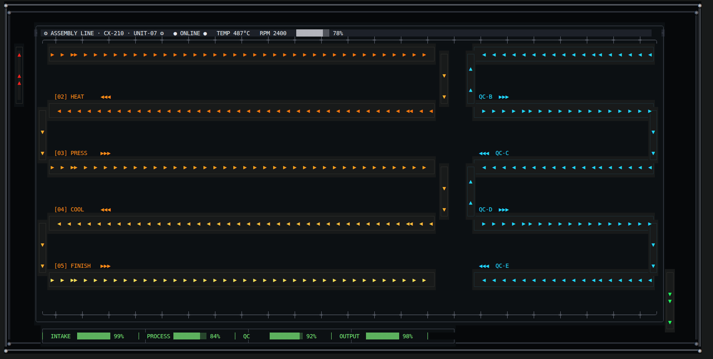
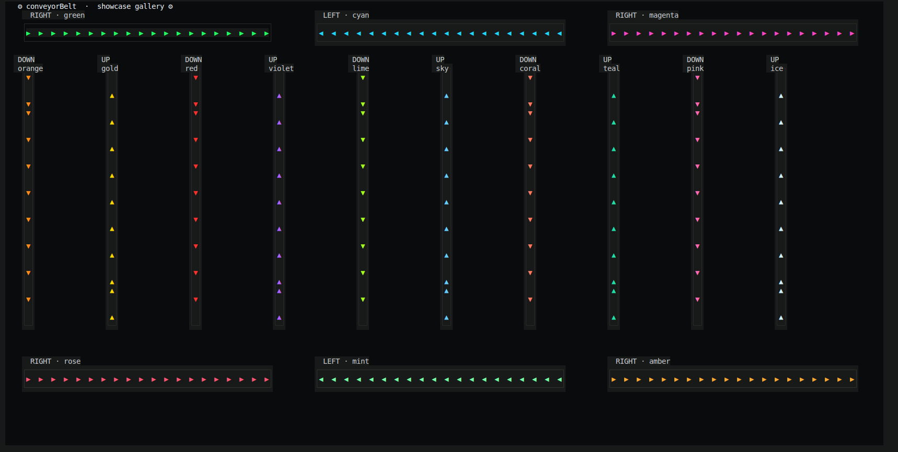

# conveyorBelt

> A single-header C++ terminal animation library for rendering animated conveyor belts — with directional flow, custom colors, and box frames — directly in your terminal.


---

<div align="center">
  
  
</div>

---
## Table of Contents

- [Overview](#overview)
- [Features](#features)
- [Requirements](#requirements)
- [Quick Start](#quick-start)
- [How It Works](#how-it-works)
- [API Reference](#api-reference)
  - [Constructor](#constructor)
  - [Directions](#directions)
  - [Methods](#methods)
- [Coordinate System](#coordinate-system)
- [Examples](#examples)
  - [Minimal Belt](#minimal-belt)
  - [Multiple Belts](#multiple-belts)
  - [Machine-Style Assembly Line](#machine-style-assembly-line)
- [Colors](#colors)
- [Terminal Notes](#terminal-notes)
- [Performance Tips](#performance-tips)
- [Gotchas & Limitations](#gotchas--limitations)
- [License](#license)

---

## Overview

`conveyorBelt` is a small, dependency-free C++ class that draws an animated conveyor belt inside a bordered box in your terminal. Each belt has:

- A **direction** (UP, DOWN, LEFT, RIGHT)
- A **length** (in cells)
- A **color** for the frame
- A **color** for the moving "fang" markers

The belt animation is done by rotating a vector of characters and redrawing each frame using ANSI escape sequences — no external libraries, no flicker, just plain `iostream` and `unistd.h`.

This makes it perfect for:

- Terminal demos and showcases
- ASCII/Unicode art machines
- Learning projects for ANSI cursor control
- Retro-industrial UI mockups

---

## Features

- ✅ **Single-header** — drop the class into your project and go
- ✅ **Directional flow** — UP, DOWN, LEFT, RIGHT with `▲ ▼ ◀ ▶` markers
- ✅ **24-bit truecolor** — set arbitrary hex colors for frame and fangs
- ✅ **Terminal-aware** — auto-detects terminal size via `ioctl`
- ✅ **Box frame** — Unicode-drawn frame (┌ ┐ └ ┘ ─ │) around each belt
- ✅ **Cursor hiding** — option to hide cursor for smooth animation
- ✅ **Zero dependencies** — only needs POSIX headers

---

## Requirements

- **C++11** or newer
- **Linux / macOS** (uses `ioctl`, `TIOCGWINSZ`, `unistd.h`, `usleep`)
- A terminal that supports **ANSI escape sequences** and **24-bit color** (most modern terminals: iTerm2, Windows Terminal, Kitty, Alacritty, GNOME Terminal, etc.)
- A font that supports **Unicode box-drawing** and **geometric shapes** (`▶ ◀ ▲ ▼ │ ─ ┌ ┐ └ ┘`)

> ⚠️ Windows users: use **WSL** or **Windows Terminal** with ANSI enabled. Native `cmd.exe` will not work without modification.

---

## Quick Start

```cpp
#include <iostream>
#include <string>
#include <vector>
#include <unistd.h>
#include <sys/ioctl.h>

class conveyorBelt {
    // ... (paste the class here)
};

int main() {
    std::cout << "\033[?25l\033[2J\033[H"; // hide cursor, clear, home

    conveyorBelt belt(10, 20, 100, conveyorBelt::RIGHT);
    belt.setColorBelt("#4d4d4d");
    belt.setColorFangs("#33FF57");
    belt.initiateBelt();

    while (true) {
        belt.nextFrame();
        usleep(150000);
    }
}
```

**Compile:**

```bash
g++ -std=c++11 main.cpp -o belt
./belt
```

---

## How It Works

The class is built around three ideas:

1. **A box frame.** Each belt is drawn inside a Unicode box. For horizontal belts (`LEFT`/`RIGHT`) the box is `length × 3` cells; for vertical belts (`UP`/`DOWN`) it's `3 × length` cells.

2. **A rotation buffer.** An internal `std::vector<std::string> beltCells` holds the current frame — a sequence of `▶` markers and ` ` (space) characters. The markers appear every 3rd cell, giving the illusion of evenly spaced teeth.

3. **Per-frame rotation.** Each call to `nextFrame()` rotates the vector in the animation direction (right/down = rotate right, left/up = rotate left) and redraws only the belt interior, using absolute cursor positioning (`\033[row;colH`) so nothing else on the screen is disturbed.

This is why you can run many belts at once — each `nextFrame()` only repaints its own interior cells.

---

## API Reference

### Constructor

```cpp
conveyorBelt(int startRow, int startCol, int length,
             conveyorBeltDirection dir = RIGHT);
```

| Parameter    | Type                      | Description                                                   |
|--------------|---------------------------|---------------------------------------------------------------|
| `startRow`   | `int`                     | 1-based row of the top-left of the **frame**                  |
| `startCol`   | `int`                     | 1-based column of the top-left of the **frame**               |
| `length`     | `int`                     | Length of the belt (used for the frame's long axis)           |
| `dir`        | `conveyorBeltDirection`   | Direction of animation. Defaults to `RIGHT`                   |

The constructor does **not** draw anything. You must call `initiateBelt()` to render the frame and first snapshot.

---

### Directions

```cpp
enum conveyorBeltDirection {
    UP,
    DOWN,
    LEFT,
    RIGHT
};
```

| Direction | Fang marker | Animation direction |
|-----------|-------------|---------------------|
| `RIGHT`   | `▶`         | moves to the right  |
| `LEFT`    | `◀`         | moves to the left   |
| `UP`      | `▲`         | moves upward        |
| `DOWN`    | `▼`         | moves downward      |

---

### Methods

#### `int initiateBelt()`

Draws the frame box, builds the initial belt state, and renders the first frame.

- Returns `0` on success.
- Throws `std::out_of_range` if the starting position is off-screen.

```cpp
belt.initiateBelt();
```

---

#### `int nextFrame()`

Advances the belt by one cell and redraws only the belt interior.

- Returns `0`.
- Call this in a loop with a sleep to animate.

```cpp
while (true) {
    belt.nextFrame();
    usleep(150000); // 150 ms
}
```

---

#### `int setColorBelt(const std::string& hexCode)`

Sets the color of the **frame** (box borders). Takes a hex string like `"#4d4d4d"`.

```cpp
belt.setColorBelt("#4d4d4d");
```

Must be called **before** `initiateBelt()` to take effect on the frame.

---

#### `int setColorFangs(const std::string& hexCode)`

Sets the color of the **moving fang markers**. Takes a hex string like `"#33FF57"`.

```cpp
belt.setColorFangs("#33FF57");
```

Can be called any time before the next `nextFrame()`.

---

## Coordinate System

All coordinates are **1-based** and **terminal-relative**:

- Row `1` = top of the terminal
- Column `1` = left edge

A belt's `startingRow` / `startingCol` refers to the **top-left corner of its frame**, not the first fang.

For example:

```cpp
conveyorBelt belt(10, 20, 100, conveyorBelt::RIGHT);
```

This places the frame's top-left corner at row 10, column 20, extending 100 columns to the right and 2 rows down (so the frame occupies rows 10–12).

For vertical belts:

```cpp
conveyorBelt belt(10, 20, 30, conveyorBelt::DOWN);
```

This occupies columns 20–22 and rows 10–39.

---

## Examples

### Minimal Belt

```cpp
int main() {
    std::cout << "\033[?25l\033[2J\033[H";

    conveyorBelt belt(10, 20, 100, conveyorBelt::RIGHT);
    belt.setColorBelt("#4d4d4d");
    belt.setColorFangs("#33FF57");
    belt.initiateBelt();

    while (true) {
        belt.nextFrame();
        usleep(150000);
    }
}
```

---

### Multiple Belts

```cpp
int main() {
    std::cout << "\033[?25l\033[2J\033[H";

    conveyorBelt a(3, 5, 60, conveyorBelt::RIGHT);
    conveyorBelt b(8, 5, 40, conveyorBelt::LEFT);
    conveyorBelt c(3, 80, 30, conveyorBelt::DOWN);
    conveyorBelt d(3, 120, 30, conveyorBelt::UP);

    a.setColorBelt("#2a2a2a"); a.setColorFangs("#FF8C1A");
    b.setColorBelt("#2a2a2a"); b.setColorFangs("#22D8FF");
    c.setColorBelt("#2a2a2a"); c.setColorFangs("#FFD700");
    d.setColorBelt("#2a2a2a"); d.setColorFangs("#FF44CC");

    a.initiateBelt();
    b.initiateBelt();
    c.initiateBelt();
    d.initiateBelt();

    while (true) {
        a.nextFrame();
        b.nextFrame();
        c.nextFrame();
        d.nextFrame();
        usleep(100000);
    }
}
```

---

### Machine-Style Assembly Line

To make a full "machine" out of belts, chain them in a **serpentine** — each row flips direction, and short vertical belts (drops) connect the ends:

```cpp
// main serpentine
conveyorBelt r1(7,  14, 117, conveyorBelt::RIGHT);
conveyorBelt r2(15, 14, 117, conveyorBelt::LEFT);
conveyorBelt r3(23, 14, 117, conveyorBelt::RIGHT);

// drops between rows
conveyorBelt d1(8,  132, 8, conveyorBelt::DOWN);
conveyorBelt d2(16, 11,  8, conveyorBelt::DOWN);

// feed in / out
conveyorBelt feed(7, 4, 9, conveyorBelt::UP);
conveyorBelt out (39, 200, 9, conveyorBelt::DOWN);
```

The visual result: a "factory line" where material flows right → down → left → down → right, with the vertical belts carrying the flow around each row. This is the recommended pattern for any assembly-line demo.

---

## Colors

Colors are specified as **hex strings** (`#RRGGBB`) and converted to 24-bit ANSI sequences:

```cpp
belt.setColorFangs("#33FF57"); // bright green
belt.setColorBelt("#4d4d4d");  // dark gray
```

Internally this becomes:

```
\033[38;2;51;255;87m
```

Make sure your terminal supports **truecolor**. Test with:

```bash
printf '\033[38;2;255;100;0mTRUECOLOR TEST\033[0m\n'
```

If the text appears orange, you're good. If not, check your `TERM` and terminal emulator settings.

---

## Terminal Notes

- The class uses `ioctl(0, TIOCGWINSZ, &w)` to detect terminal size at construction time.
- **Resizing the terminal after construction** is not supported — belts are drawn relative to their original coordinates. Reconstruct the belt if the size changes.
- The cursor is hidden only if you explicitly print `\033[?25l`. Restore it with `\033[?25h` before exiting.
- All drawing uses absolute cursor positioning, so the current cursor position is irrelevant — you can interleave other drawing code safely.

---

## Performance Tips

- **Batch your redraws.** Each `nextFrame()` writes dozens of escape sequences. If you're animating many belts, call all `nextFrame()`s, then `std::flush` once.
- **Use a reasonable frame delay.** `usleep(80000)` (80 ms, ~12 FPS) is a good balance. `usleep(150000)` (150 ms, ~6 FPS) is gentler on slow terminals.
- **Avoid clearing the screen every frame.** The library is designed for **incremental redraws** — you should call `\033[2J` once at startup, never again.
- **Fewer belts = smoother.** On slow terminals, >20 simultaneous belts can stutter.

---

## Gotchas & Limitations

| Issue | Notes |
|-------|-------|
| **Not thread-safe.** | The class mutates state in `nextFrame()`. Don't call from multiple threads. |
| **No resize support.** | Terminal size is captured once at construction. |
| **No clipping.** | If `startingRow + length` exceeds terminal bounds, output may be garbled. |
| **Fixed belt thickness.** | Belts are always 3 cells thick (frame + 1 interior row/col). |
| **Fixed fang spacing.** | Fangs appear every 3rd cell. Not configurable in this version. |
| **No borders off-screen safety.** | `initiateBelt()` checks the start position, but not the end — make sure `startCol + length <= terminalCols` for horizontal belts, and `startRow + length <= terminalRows` for vertical. |
| **POSIX-only.** | Uses `unistd.h` and `sys/ioctl.h`. On Windows, use WSL or port the terminal-size detection. |

---

## License

MIT — do whatever you want, no warranty, no attribution required (but appreciated).

---

## Contributing

This is a small educational project. If you want to extend it, here are some natural next steps:

- **Diagonal belts** (◤ ◥ ◣ ◢)
- **Configurable fang spacing** (`fangSpacing` constructor arg)
- **Configurable thickness** (1-row "thin" belts)
- **Text-on-belt mode** (carry a string payload)
- **Async animation** (background thread)

Pull requests welcome.

---

<p align="center"><em>Built for terminal tinkerers. Go make something that clanks.</em> ⚙</p>